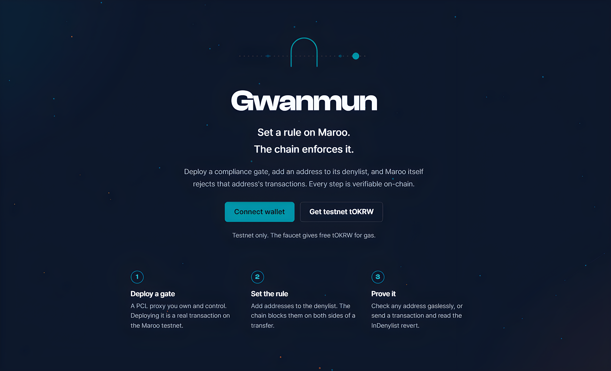

<div align="center">

# Gwanmun

**Set a rule on Maroo. The chain enforces it.**

A tool for setting and proving on-chain compliance rules on the Maroo testnet.

</div>

<p align="center"></p>

---

Gwanmun lets you deploy a gate you own on the Maroo testnet, bind a denylist to it, and prove on-chain that the protocol, not this app, enforces the rule. The name is the Korean word for a gateway or checkpoint (관문).

Maroo is a Hashed Open Finance Layer 1 with a Programmable Compliance Layer (PCL) built into the chain. Gwanmun is a small, focused dApp that puts that layer in your hands: set a rule, watch the chain turn away anyone who breaks it, and verify every step yourself.

> Testnet only. Not affiliated with Maroo or Hashed Open Finance.

## What it does

- **Deploy a gate.** A PCL proxy you own and control. Deploying it is a real transaction on Maroo.
- **Set a denylist.** Add or remove addresses. Each change is a real transaction.
- **Check any address.** A free, gasless simulation (eth_call) that reproduces the chain's verdict without sending anything.
- **Send through the gate.** Route a real transaction through your gate and watch it pass or get stopped, tied to the actual on-chain result.
- **Inspect the policy.** Read the exact policy bytes stored on the PCL precompile for your gate, decoded.
- **Verify everything.** Every claim the app makes is read from the chain and linkable in the block explorer.

## How the denylist works

A denylist is enforced by the Maroo protocol on both sides of a transfer. For a gate whose denylist contains an address D:

| Sender on denylist | Sends value to a denylisted address | Result |
| --- | --- | --- |
| No | No | Allowed |
| No | Yes | Rejected, `InDenylist` |
| Yes | No | Rejected, `InDenylist` |
| Yes | Yes | Rejected, `InDenylist` |

A transaction is allowed only when neither side involves a denylisted address. A zero-value call that merely targets a denylisted address, without sending value, is allowed. The revert is `InDenylist(address)` (selector `0x0201b218`), naming the denylisted party, which may be the sender or the recipient.

These semantics were verified by read-only probing against a live gate. The method and the full case table are in [docs/FINDINGS.md](docs/FINDINGS.md).

## Why it matters

On most chains, compliance is enforced by the application. You have to trust an app's front end or server to apply the rule, and the chain itself knows nothing about it. Maroo builds compliance into the Layer 1 through the PCL, so the rule you set is enforced by the protocol, at the moment of execution, for any transaction routed through your gate, no matter which interface sends it.

## Try it

### Prerequisites

- Node.js 20.19 or newer
- A browser wallet (MetaMask or compatible)
- A little testnet tOKRW for gas, from the faucet below

### Run locally

```bash
cd web
npm install
npm run dev
```

Open the printed local URL and connect your wallet.

### Connect to the Maroo testnet

| Field | Value |
| --- | --- |
| Network | Maroo Testnet |
| Chain ID | 450815 (0x6E0FF) |
| Currency | tOKRW |
| RPC | https://rpc-testnet.maroo.io |
| Explorer | https://explorer-testnet.maroo.io |
| Faucet | https://faucet.maroo.io |

The app can add the network to your wallet for you, and links straight to the faucet.

## On-chain addresses

| Contract | Address |
| --- | --- |
| PCL precompile | `0x1000000000000000000000000000000000000005` |
| Gate logic (GwanmunForwarder) | `0x7ff637c15ae8685e1fde8c0c2612cd17d8cb3ff8` |

Each gate is a Transparent PCL proxy you deploy, pointing at the shared gate-logic contract.

## Project structure

```
web/        the dApp (Vite + React + TypeScript)
contracts/  the Solidity gate logic and experiments (Foundry)
scripts/    read-only probes used to verify PCL behavior
docs/       FINDINGS.md: verified PCL semantics and probe results
```

## Built with

- Vite, React, and TypeScript
- viem and wagmi for chain access and wallet connection
- Clash Display, Pretendard, and JetBrains Mono

## Disclaimer

Gwanmun is an independent project built on the Maroo testnet for testing and demonstration. It is not affiliated with Maroo or Hashed Open Finance. It runs on testnet only and moves no real value.

## License

MIT. See [LICENSE](LICENSE).
